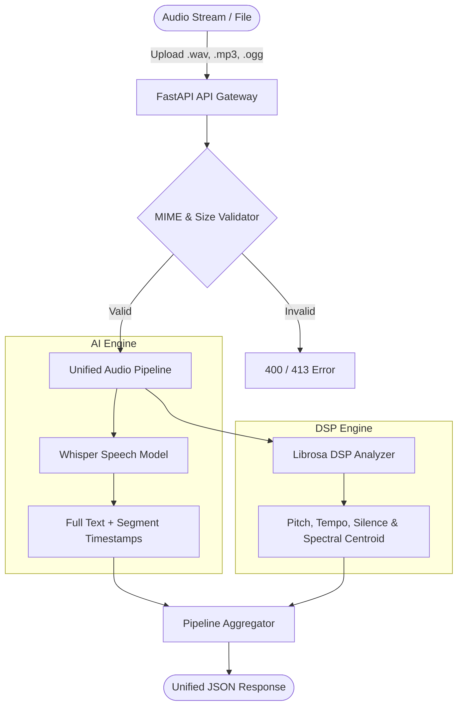

# 🎙️ AudioSense AI — Speech & Acoustic Intelligence Platform

[](https://audiosense-ai-platform.onrender.com/docs)
[](https://github.com/JohnAlva/audiosense-ai-platform/actions)
[](#)
[](#)
[](#)
[](#)
[](LICENSE)

An enterprise-ready **Audio Intelligence and Speech Digital Signal Processing (DSP)** platform. Built with **FastAPI**, **OpenAI Whisper**, and **Librosa** to deliver real-time speech transcription with word-level timestamps alongside acoustic signal metrics (pitch, tempo, silence ratios, and spectral analysis).

---

## ⚡ Architecture Flow



---

## 🚀 Key Features

* **🗣️ Speech-to-Text with Timestamps:** Automated speech recognition powered by OpenAI Whisper with multi-language identification.
* **🎛️ Acoustic Digital Signal Processing:** Calculates pitch (fundamental frequency $F_0$), tempo (BPM), silence ratios, and spectral centroid using Librosa.
* **🛡️ Production Ready:** Validated with Pydantic v2 schemas, strict MIME type filtering, and size caps.
* **📑 Auto-Documented:** Interactive OpenAPI Swagger UI (`/docs`) and ReDoc (`/redoc`) enabled out of the box.
* **🐳 Dockerized:** Container with `ffmpeg` and `libsndfile1` pre-configured for instant zero-dependency deployment.

---

## 📦 Quick Start with Docker

Run the entire platform locally in one command:

```bash
docker compose up -d
```

Open your browser at [http://localhost:8000/docs](http://localhost:8000/docs) to access the interactive Swagger documentation.

---

## 📑 API Endpoints Overview

| Method | Endpoint | Description |
| :--- | :--- | :--- |
| `GET` | `/api/v1/health` | Service health status and active model |
| `POST` | `/api/v1/transcribe` | Transcribe speech to text with segment timestamps |
| `POST` | `/api/v1/analyze` | Extract acoustic signal metrics (pitch, tempo, energy) |
| `POST` | `/api/v1/pipeline` | Unified pipeline: transcription + acoustic DSP |

---

## 🧪 Running Automated Tests

```bash
pytest -v tests/
```

---

## 👨‍💻 Author

**Juan Pablo Alvarez Hernandez**  
*Fullstack Developer | Backend Specialist*  
* GitHub: [@JohnAlva](https://github.com/JohnAlva)  
* LinkedIn: [alvcode](https://www.linkedin.com/in/alvcode)

